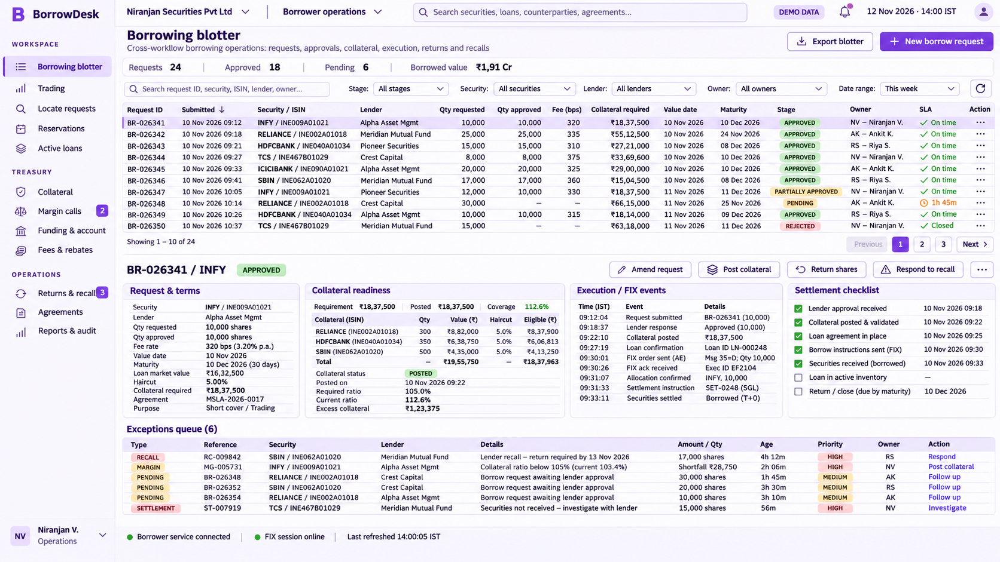

# BorrowDesk — white and purple UI designs

Generated desktop design references for the BorrowDesk screens, using the shared LendDesk white-and-purple theme.

These are visual mockups with illustrative sample data, not screenshots of live backend records. Controls, pagination, and workflows shown in the designs are visual references rather than a statement of implemented API support. The application implementation is maintained separately from these design assets.

## Screens

| Screen | Design |
|---|---|
| Borrowing Blotter | [01-borrowing-blotter.png](01-borrowing-blotter.png) |
| Trading | [02-trading.png](02-trading.png) |
| Locate Requests | [03-locate-requests.png](03-locate-requests.png) |
| Reservations | [04-reservations.png](04-reservations.png) |
| Active Loans | [05-active-loans.png](05-active-loans.png) |
| Collateral | [06-collateral.png](06-collateral.png) |
| Margin Calls | [07-margin-calls.png](07-margin-calls.png) |
| Funding & Account | [08-funding-account.png](08-funding-account.png) |
| Fees & Rebates | [09-fees-rebates.png](09-fees-rebates.png) |
| Returns & Recalls | [10-returns-recalls.png](10-returns-recalls.png) |
| Agreements | [11-agreements.png](11-agreements.png) |
| Reports & Audit | [12-reports-audit.png](12-reports-audit.png) |

## Shared palette

| Use | Color |
|---|---|
| Canvas | `#f8f7ff` |
| Sidebar | `#fbfaff` |
| Cards and top bar | `#ffffff` |
| Primary actions | `#6d5ce7` |
| Selection | `#ece9fe` |
| Text | `#25223a` |
| Secondary text | `#756f91` |
| Borders | `#e4e0f4` |

Green, amber, and red retain their financial status meanings. The same shell, navigation, table styling, and action hierarchy carry across the screens.

## Preview

