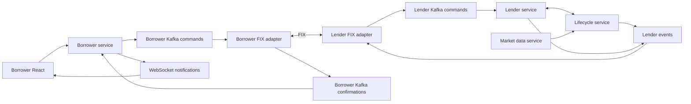

# Service boundaries

One FIX-adapter codebase can run as two deployments: borrower initiator and lender acceptor. The two sessions exchange an explicitly agreed message contract. The borrower backend contains no QuickFIX/J dependency or session configuration. Internal calculation events do not need to pass through FIX; only counterparty-facing requests/results do.

| Service | Authoritative responsibility |
|---|---|
| Borrower | Organizations, users, borrower cash/holdings, paper trading, borrower request state, local projections |
| Lender | Lendable inventory, request decisions, authoritative reservations, securities settlement, lender-initiated recalls |
| Lifecycle | Daily fee/rebate accruals, EOD collateral valuation/coverage checks, margin obligations, deadline records, reservation/recall timeouts, defaults, buy-in workflow |
| FIX adapter | FIX translation, session logon, sequencing, reconnect, resend, transport acknowledgments, counterparty routing |
| Market data | Security master and delayed OHLCV prices |
| Payments/custody integration | Cash/securities movement confirmation; may initially be simulated outside the borrower backend |

The lender can delegate rule-based decisions to the lifecycle service. That service still acts under the lender's authority and the MSLA. Neither a FIX delivery acknowledgment nor a Kafka acknowledgment is a business approval or settlement confirmation.

## Locate, reservation and loan

1. Borrower commits a request and its outbox event in the same transaction.
2. The adapter forwards the command to the lender's adapter.
3. Lender accepts/rejects the locate and sends the decision back.
4. Borrower separately requests a reservation. Lender atomically reserves its inventory and records the deadline, coordinating with the lifecycle service.
5. A confirmed reservation can be drawn down through a loan request. Borrower locally blocks the proposed collateral; lender/settlement integration validates and settles the transaction.
6. Confirmations separately update collateral and loan state. Only confirmed borrowed stock can be sold.

Borrower-side remaining reservation quantity is a local protection against submitting overlapping drawdowns. It is not the lender's inventory ledger. Expiry/restoration quantities arrive from the owner; the borrower does not run an inventory-unlock scheduler.

## EOD checks, margin calls, and recall

The lifecycle service consumes settled loan/collateral changes and market data. Its EOD job calculates coverage, applies agreement rules, stores authoritative results and obligations, and emits counterparty notifications. Borrower projects those values without recalculating or issuing calls.

A borrower response allocates collateral or requests a return. A request alone cannot satisfy an obligation: the owner waits for confirmed settlement and publishes the new fulfillment status. The borrower displays that reported status.

A recall originates from lender action or an authorized lender rule, subject to the agreement. Lifecycle tracks its deadline and any default progression. Borrower never initiates a lender recall.

## Fees and rebates

Lifecycle owns rates/day-count application, daily valuation bases, accrual schedules, invoice periods, and rebate obligations. Borrower receives reported accruals and bills. It can request fee payment and display rebates received. Account balances change only from confirmed movement events; reading a fee statement never performs an accrual calculation.

## Deadline processing and default

Kafka does not by itself provide arbitrary delayed delivery. Persist `due_at`, object ID, state/version, and completion state in the lifecycle service. Its scheduler or a durable scheduling system publishes due commands. Make them idempotent and recheck the current state before acting, so an old timer cannot expire a fulfilled recall or completed reservation.

Default and buy-in actions are owned by lifecycle/lender workflows. Borrower receives read projections plus explicit account/position/loan confirmations; it does not execute a buy-in or liquidate collateral from a local price estimate.

## Consistency

- Each service owns its database. No cross-service SQL writes or foreign keys.
- Commands carry a stable event ID and organization/counterparty correlation.
- Borrower publishes with a transactional outbox. A crash can produce a duplicate; consumers must deduplicate by event ID.
- Incoming borrower projections use an inbox and per-resource versions to ignore duplicate/stale confirmations.
- Serialize relevant borrower writes on the organization row to prevent double use of cash or stock.
- Kafka messages should use organization ID as the partition key. Keep resource versions monotonic across every producer that can update that resource.
- Remote inventory and settlement failures are resolved by explicit rejected/restored/released events, not by assuming success after a timeout.
